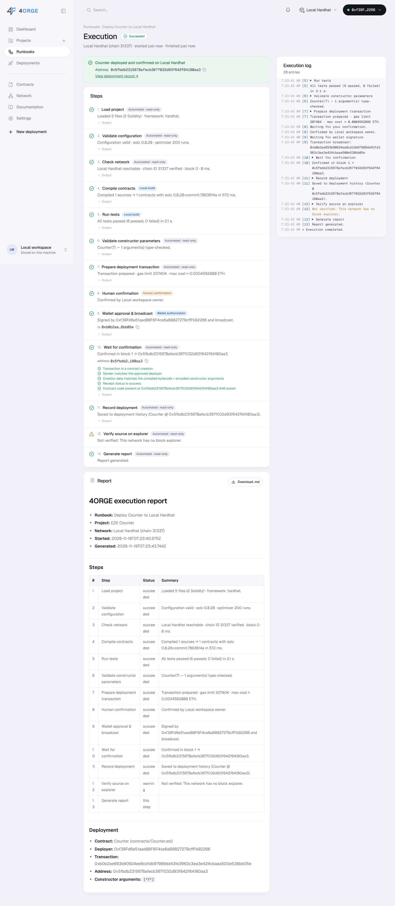

<p align="center"></p>

# 4ORGE

**Your complete smart contract deployment and automation workspace for QIE.**

4ORGE (pronounced *Forge*) is developer infrastructure for [QIE Blockchain](https://www.qie.digital). It brings creating, compiling, testing, configuring, deploying and tracking Solidity contracts together in one web application. Deployments are built from reusable, validated workflows called **Runbooks**, and every transaction is signed by your own wallet (MetaMask, Rabby, …).

Built for **QIE Blockchain Hackathon 3.0 — Developer Infrastructure**.



---

## The problem

Shipping a contract usually means juggling many tools: a Solidity toolchain, compiler versions, dependency installs, test runners, RPC configuration, wallet setup, deployment scripts, explorers and a spreadsheet of addresses. Every step is manual, easy to get wrong and hard to repeat.

## What 4ORGE does

| | |
|---|---|
| **Projects** | Start from a template, upload a Hardhat/Foundry folder, or import a GitHub repository. 4ORGE detects contracts, compiler settings, tests and dependencies by *reading* config files (never executing them). |
| **Compilation** | Real Solidity compilation with the official compiler builds. Versions are chosen from your config or pragmas, downloaded from the npm registry and checked against their SHA-512 integrity hash. npm imports such as `@openzeppelin/contracts` are resolved safely, without running install scripts. Errors, warnings, ABIs and bytecode are shown. |
| **Testing** | Runs your **Hardhat 3** test suites (Solidity `*.t.sol` tests and `node:test` + viem TypeScript tests) in an isolated sandbox, and shows per-test results, failure messages and durations. |
| **Runbooks** | A versioned JSON/YAML workflow format with an explicit allowlist of steps: validate → network check → compile → test → validate args → prepare → human confirmation → wallet signature → on-chain confirmation → record → verify → report. Create, reorder, save, import/export, run, retry and audit them. |
| **Deployment** | Builds the deployment transaction, estimates gas, checks the balance and shows a full summary. Your wallet signs it. 4ORGE **independently validates the receipt from the chain** (sender, creation code, status, deployed code) before recording success. |
| **History & contracts** | A permanent, searchable record of every deployment with explorer links, gas data, constructor arguments and verification status. |
| **Networks** | QIE Testnet (default) and QIE Mainnet. The chain ID is verified live via `eth_chainId`, wallet/network mismatches are detected, one-click switching is available, and you can set a custom RPC. |
| **API** | A versioned REST API (`/api/v1`). The 4ORGE UI itself uses it. |

## How a deployment works

```
Load project ─ Validate config ─ Check network (eth_chainId) ─ Compile (solc) ─ Run tests (Hardhat 3)
     │
     └─ Type-check constructor args ─ Prepare tx + estimate gas ─ ⏸ You review
            │
            └─ ✍ Wallet signs & broadcasts ─ Receipt fetched & validated on-chain ─ Recorded ─ Verified ─ Report
```

Steps that only read or build run automatically on the server. The wallet step always needs your signature in your wallet, and 4ORGE never sees your keys. If a step fails you can retry it; a broadcast transaction is never sent twice.

## Technology

Next.js 16 (App Router) · TypeScript · Tailwind CSS 4 · Lucide · Solidity (official `soljson` builds) · Hardhat 3 · viem · EIP-6963 wallets · Supabase (Postgres + Row Level Security) · Vitest · Playwright.

---

## Quick start (local mode)

You need **Node.js 22.12 or newer** ([download](https://nodejs.org)). Then, in a terminal:

```bash
git clone https://github.com/TeevincsCrypt/4orge.git
```

```bash
cd 4orge
```

```bash
npm install
```

```bash
npm run dev
```

Open **http://localhost:3000** to see the landing page, then click **Open workspace**. That's it: with no configuration, 4ORGE runs in **local mode**. It is a single-user workspace whose data lives in the `.forge-data/` folder on your computer, and it only accepts connections from your own machine.

> `npm install` also installs the Hardhat toolchain used for tests (in `runner/`). If that step was interrupted, run `npm run setup:runner`.

### Deploy your first contract to QIE Testnet

1. **Get test QIE.** Install [MetaMask](https://metamask.io) or [Rabby](https://rabby.io), then request test tokens from the [QIE faucet](https://www.qie.digital/faucet).
2. **Create a project.** Click *New project* and pick the *Counter* template.
3. **Compile and test.** Use the *Build* tab, then the *Tests* tab. All tests should pass.
4. **Deploy.** Click *Deploy*, enter a starting number for the counter, and keep *QIE Testnet* selected. Click *Create Runbook & start*.
5. Watch the checks run. When asked, **review** the summary, **connect your wallet**, switch it to QIE Testnet with one click, and **sign**.
6. 4ORGE waits for the real receipt, validates it and records the deployment with an explorer link.

### Rehearse without spending anything (local chain)

```bash
npm run chain
```

Leave that running, then start 4ORGE with the local network enabled:

```bash
FORGE_ENABLE_LOCAL_CHAIN=true npm run dev
```

In MetaMask, add the network `http://127.0.0.1:8545` (chain ID 31337) and import one of the test accounts printed by `npm run chain`. **Those keys are public. Never use them on a real network.**

---

## Configuration

Copy `.env.example` to `.env.local` and fill in only what you need. Everything is optional.

| Variable | Purpose |
|---|---|
| `NEXT_PUBLIC_SUPABASE_URL`, `NEXT_PUBLIC_SUPABASE_ANON_KEY` | Enables multi-user cloud mode with sign-in (Supabase Auth) and Postgres storage protected by Row Level Security. Apply `supabase/migrations/*.sql` first. |
| `GITHUB_CLIENT_ID`, `GITHUB_CLIENT_SECRET`, `FORGE_SESSION_SECRET` | GitHub OAuth for importing **private** repositories. Public repositories work without these. |
| `FORGE_TEST_RUNNER` | `all` (default in local mode), `solidity` (default in Supabase mode) or `disabled`. |
| `FORGE_ENABLE_LOCAL_CHAIN` | Shows the *Local Hardhat* network (chain 31337). |
| `FORGE_ENABLE_MAINNET_DEPLOYMENTS` | **Off by default.** Mainnet deployments stay locked until the owner deliberately enables this. |

See the [deployment guide](docs/deployment-guide.md) for hosting.

## Testing

| Command | What it checks |
|---|---|
| `npm run typecheck` | TypeScript |
| `npm run lint` | ESLint |
| `npm test` | Unit tests: Runbook validation, path safety, ABI argument parsing, detection, Hardhat output parsing, network config, compiler version selection, storage isolation |
| `npm run test:integration` | Real compilation (including OpenZeppelin from npm) and real Hardhat test runs |
| `npm run test:e2e` | The whole product in a real browser against a real local EVM: create → compile → test → Runbook → review → wallet network switch → sign → on-chain validation → record. Also proves a forged transaction hash is rejected. Run `npm run build` first and set `E2E_PROD=1` for a production run. |
| `tests/sql/run.sh` | Applies the Supabase migration to a local Postgres and verifies Row Level Security (needs PostgreSQL installed) |
| `npm run build` | Production build |

## Documentation

- [Getting started](docs/getting-started.md)
- [Runbooks](docs/runbooks.md): the format, steps and execution model
- [QIE networks](docs/qie-networks.md)
- [Architecture & security](docs/architecture.md)
- [API reference](docs/api.md)
- [Deployment guide](docs/deployment-guide.md)
- [Development progress log](docs/PROGRESS.md)
- [Brand assets & logo usage](docs/brand/README.md)

The same documents are available inside the app under **Documentation**.

## Current limitations (honest status)

- **QIE Testnet deployment has not yet been executed from the development environment.** The build sandbox could not reach QIE's RPC hosts. The full flow is proven end-to-end against a real local EVM (`npm run test:e2e`), and the QIE configuration (chain IDs 1983/1990) is checked live by `eth_chainId` whenever the app runs. Running the Testnet flow needs a funded Testnet wallet; see *Deploy your first contract* above.
- **Explorer verification**: 4ORGE submits verification to explorers that expose the Blockscout API. Whether QIE's explorers expose it is detected at runtime. If they don't, the status is shown as *unsupported*, never as verified.
- **Supabase mode** is implemented (adapter, auth, migration with RLS tested on Postgres) but has not been run against a hosted Supabase project, because no credentials were available during development.
- Tests run with Hardhat 3. Hardhat 2 / ethers-style JavaScript tests may need small updates, and Foundry `forge-std` tests are not run yet.
- Library linking (contracts with external libraries) and upgradeable-proxy deployments are not supported yet.
- In local mode, JavaScript/TypeScript tests run as normal processes on your machine (they are your own code). For shared hosting, run the test runner in a container sandbox (see the architecture doc).

## Roadmap

- Testnet demo deployment and explorer verification confirmation on QIE.
- Mainnet deployments behind an explicit, per-deployment owner authorization.
- Container-isolated test runners for multi-tenant hosting.
- Contract interaction console (read/write calls from the ABI).
- Multi-contract Runbooks (deploy and wire several contracts, proxies, post-deploy calls).
- CLI and CI integration (run Runbooks from GitHub Actions through the API with personal access tokens).
- Foundry test execution and library linking.

## License

[MIT](LICENSE)
